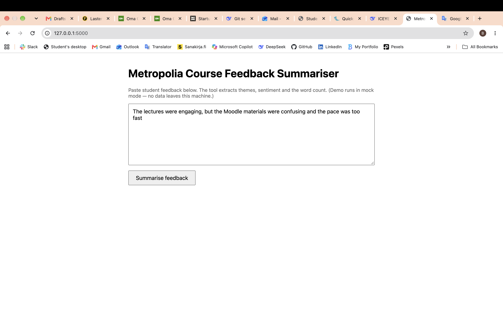
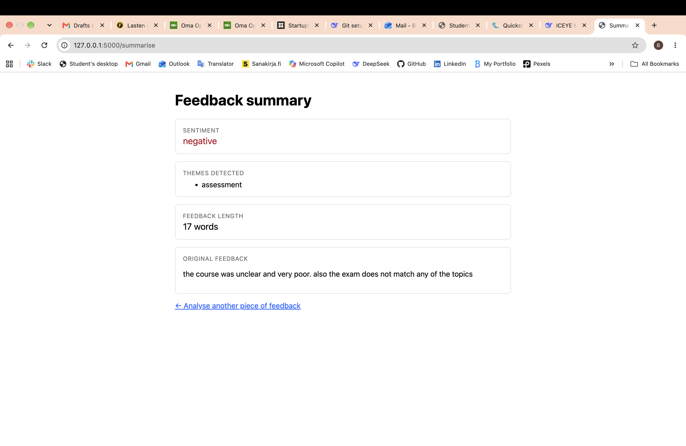

# Metropolia Course Feedback Summariser

A small Flask web app built for the Metropolia "Student Coders for AI projects" assignment. 

## The Problem
Metropolia collects large amounts of free-text student feedback. Reading hundreds of open responses manually is slow and inconsistent. This tool surfaces the signal: what the feedback is about, whether it is positive or negative, which themes are mentioned, and which specific issue needs attention first.

## How it works
The app accepts pasted feedback, analyses it, and returns a structured summary. 

**Mock Mode:** This demo runs in mock mode. The analysis function is a transparent rule-based stand-in for an LLM. It keyword-matches themes (e.g., teaching, pace, assessment), scores sentiment against positive/negative word lists, and extracts the most negative-sounding sentence as the "Top Issue to Fix". No data leaves the machine and no API key is needed.

The logic is deliberately isolated so replacing it with a real LLM API call (like Gemini or OpenAI) would require no changes to the Flask routes or templates.

## Screenshots

### Input Form


### Result Page


## How to run this locally

1. Clone this repository and navigate into the folder.
2. Create and activate a virtual environment:
   ```bash
   python3 -m venv venv
   source venv/bin/activate  # On Windows use: venv\Scripts\activate